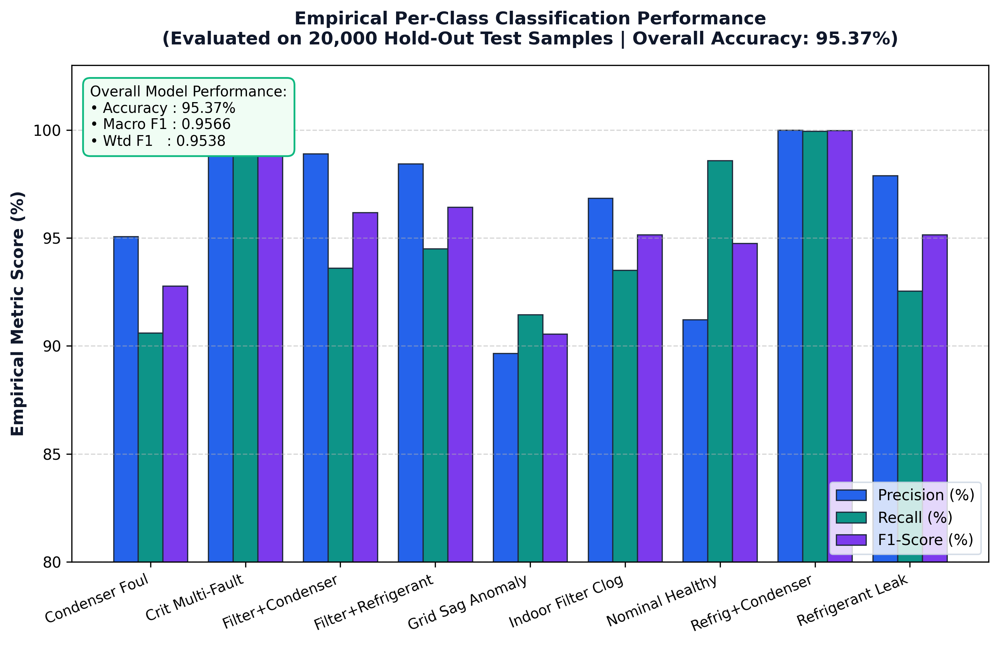
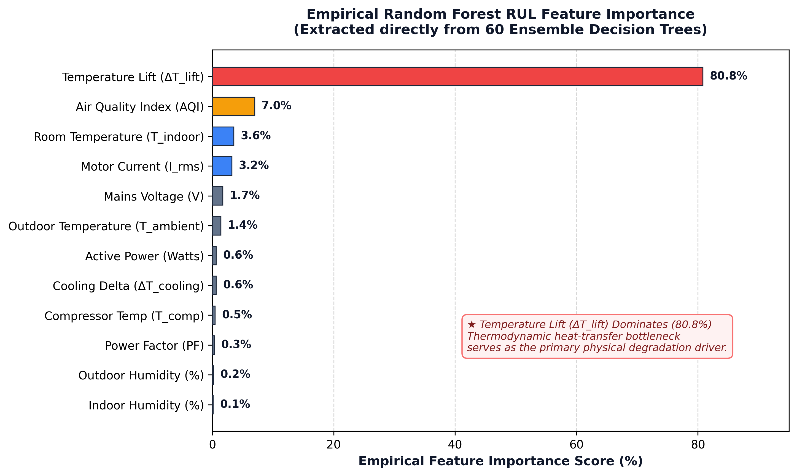
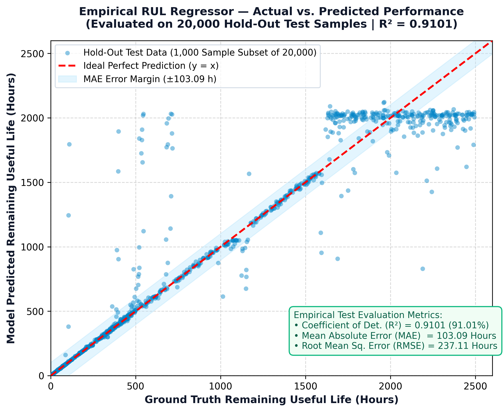
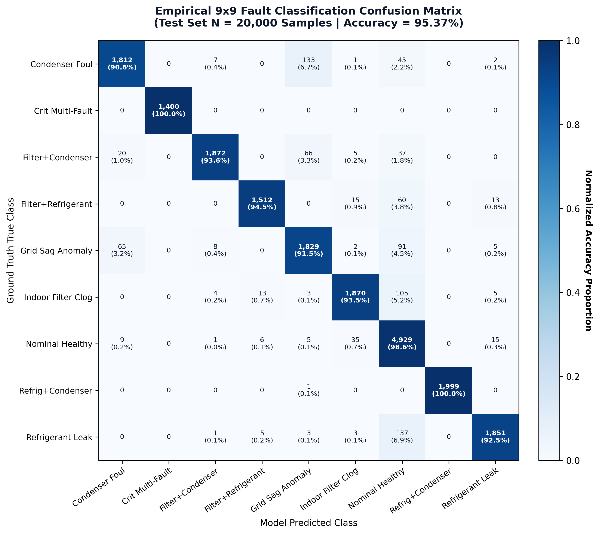

# ❄️ Air Conditioner Digital Twin & Predictive Maintenance System

[](https://www.python.org/)
[](https://www.espressif.com/)
[](https://mosquitto.org/)
[](https://scikit-learn.org/)
[](https://opensource.org/licenses/MIT)

An end-to-end Cyber-Physical Digital Twin system designed for real-time condition monitoring, automated fault classification, and Remaining Useful Life (RUL) prognostics of residential and commercial air conditioning systems.

---

## 📌 Key Highlights
- **Real-Time IoT Telemetry**: Streams 12 thermodynamic and electrical parameters every 2.5 seconds using ESP32 and MQTT.
- **Physics-Informed Feature Engineering**: Computes real-time Temperature Lift ($\Delta T_{\text{lift}}$), Cooling Delta ($\Delta T_{\text{cooling}}$), and Active Power Factor ($PF$).
- **Multi-Class Fault Localization**: Decision Tree Classifier identifies 9 compound operational states with **95.37% Accuracy** and **0.9566 Macro F1-Score**.
- **RUL Prognostics**: Random Forest Regressor predicts remaining operational hours ($R^2 = 0.9101$, $\text{MAE} = 103.09\text{ h}$) based on Arrhenius thermal degradation.
- **Dual Visual Twin Interfaces**: Real-time Node-RED Dashboard 2.0 and Flask web twin with automatic Telegram push notifications.

---

## 📊 Empirical ML Performance

| Model | Target | Algorithm | Accuracy / $R^2$ | Key Metric |
| :--- | :--- | :--- | :---: | :---: |
| **Fault Classifier** | 9 Operational States | Regularized Decision Tree | **95.37%** | Macro F1: 0.9566 |
| **RUL Regressor** | Remaining Useful Life (Hours) | Random Forest (60 Trees) | **$R^2 = 0.9101$** | MAE: 103.09 h |

### Empirical Performance Visualizations
<p align="center">
  
  
</p>
<p align="center">
  
  
</p>

---

## 🛠️ Circuit Diagram & Hardware Pinout
- **Master MCU**: ESP32 DevKit V1
- **Indoor Unit (IDU)**: DHT22 (GPIO 4)
- **Outdoor Unit (ODU)**: DHT22 (GPIO 18)
- **Compressor Dome**: DS18B20 (GPIO 5 with 4.7kΩ pull-up)
- **Indoor Filter / Air Quality**: MQ135 (GPIO 34 ADC1)
- **Compressor Vibration**: SW-420 (GPIO 27)
- **Mains Electrical Power**: Wi-Fi Smart Plug (Voltage, Current, Power, Power Factor)

---

## 🚀 Quickstart Guide

### 1. Clone the Repository
```bash
git clone https://github.com/maddan23032005/ac-digital-twin-predictive-maintenance.git
cd ac-digital-twin-predictive-maintenance
```

### 2. Install Dependencies
```bash
pip install -r requirements.txt
```

### 3. Run Pipeline & Train Models
```bash
python run_ac_ml_pipeline.py
```

### 4. Launch Digital Twin Services
```bash
# Terminal 1: Mosquitto Broker
mosquitto -c mosquitto_config/mosquitto.conf

# Terminal 2: Node-RED
node-red

# Terminal 3: Flask Digital Twin Backend
python app.py
```

Access the interfaces at:
- **Node-RED Dashboard**: `http://localhost:1880/dashboard`
- **Flask Digital Twin**: `http://localhost:5000`

---

## 📜 Academic Citations & References
1. **Hosamo et al. (2022)**. *"A Digital Twin predictive maintenance framework of air handling units based on automatic fault detection and diagnostics."* *Energy and Buildings*, 261, 111988. [DOI: 10.1016/j.enbuild.2022.111988](https://doi.org/10.1016/j.enbuild.2022.111988)
2. **Xie et al. (2023)**. *"Digital twin enabled fault detection and diagnosis process for building HVAC systems."* *Automation in Construction*, 146, 104695. [DOI: 10.1016/j.autcon.2022.104695](https://doi.org/10.1016/j.autcon.2022.104695)
3. **AHRI Standard 210/240 (2023)**. *"Performance Rating of Unitary Air-Conditioning & Air-Source Heat Pump Equipment."* Air-Conditioning, Heating, and Refrigeration Institute.
4. **ISO 10816-3 (2018)**. *"Mechanical vibration — Evaluation of machine vibration on non-rotating parts."* International Organization for Standardization.

---

## 📄 License
This project is licensed under the MIT License.
